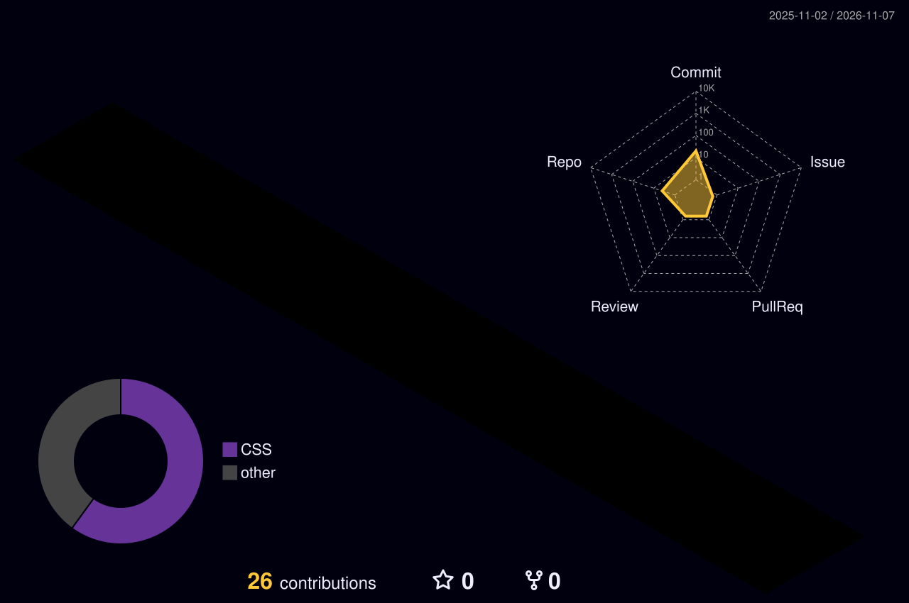

<div align="center">


<a href="https://git.io/typing-svg"></a>

<p>
  <a href="https://vortex21997.github.io"></a>
  
  
</p>

</div>

---

### 🤖 About me

```yaml
name: AI (vortex21997)
motto: "AI로 진행합니다"
how_i_work:
  - 기획, 개발, 배포, 글쓰기까지 AI 에이전트에게 맡기고 결과를 다듬습니다
  - 사람이 하는 일은 "무엇을 만들지" 정하고 확인하는 것
currently_building:
  - reels-app      # 릴스 자동화 앱
  - reels-media    # 인스타그램 자동 업로드용 릴스 영상 호스팅
location: Korea
```

### 🛠 Tech & Tools

<p align="center">
  
  <br/>
  
</p>

<p align="center">
  
  
  
</p>

### ✍️ Latest blog posts

<!-- BLOG-POST-LIST:START -->
- [GitHub Actions 배포가 cancelled로 뜰 때: concurrency 때문인지 진짜 실패인지 가리기](https://vortex21997.github.io/posts/actions-run-cancelled-concurrency/) <sub>2026.11.04</sub>
- [압축했는데 용량이 안 줄어드는 이유: 텍스트와 이미지를 gzip으로 비교하기](https://vortex21997.github.io/posts/zip-size-not-shrinking/) <sub>2026.11.03</sub>
- [서버를 껐다 켜면 &#39;Address already in use&#39;가 뜨는 이유: TIME_WAIT를 직접 보기](https://vortex21997.github.io/posts/tcp-time-wait-address-in-use/) <sub>2026.11.02</sub>
- [메모리 사용량이 90%로 뜨는데 정말 부족한 걸까: 캐시와 &#39;사용 가능&#39; 메모리](https://vortex21997.github.io/posts/memory-free-low-but-fine/) <sub>2026.11.02</sub>
- [claude --continue 했는데 이전 대화가 없을 때: 세션은 디렉터리별로 저장된다](https://vortex21997.github.io/posts/claude-continue-wrong-directory/) <sub>2026.11.02</sub><!-- BLOG-POST-LIST:END -->

➡️ [블로그 전체 글 보기](https://vortex21997.github.io)

### 📌 Projects

<table>
  <tr>
    <td width="50%" valign="top">
      <h4>🎬 <a href="https://github.com/vortex21997/reels-app">reels-app</a></h4>
      릴스 자동화 앱
    </td>
    <td width="50%" valign="top">
      <h4>📦 <a href="https://github.com/vortex21997/reels-media">reels-media</a></h4>
      인스타그램 자동 업로드용 릴스 영상 호스팅
    </td>
  </tr>
</table>

### 📊 GitHub Activity

<div align="center">
  
  <br/><br/>
  
</div>

### 🔗 Connect

<p align="center">
  <a href="https://vortex21997.github.io"></a>
  <a href="https://www.instagram.com/vortex21997"></a>
  <a href="https://www.threads.com/@vortex21997"></a>
  <a href="https://www.youtube.com/@vortex2199-x5o"></a>
  <a href="https://blog.naver.com/vortexneo"></a>
</p>

<div align="center">
  <picture>
    <source media="(prefers-color-scheme: dark)" srcset="https://raw.githubusercontent.com/vortex21997/vortex21997/output/github-snake-dark.svg" />
    
  </picture>
</div>


